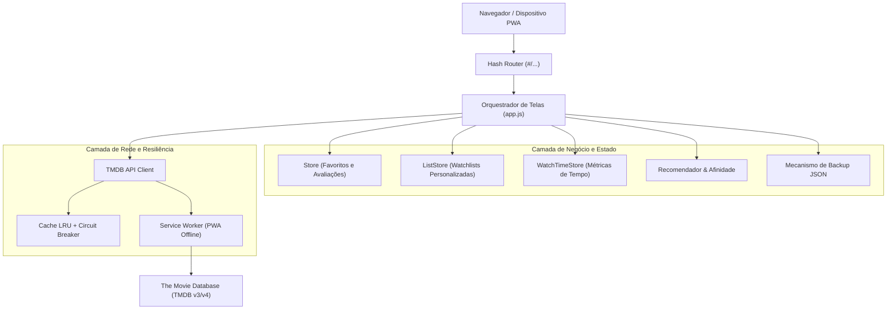
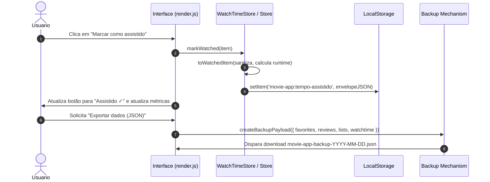
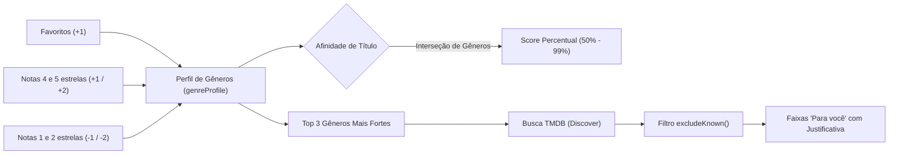
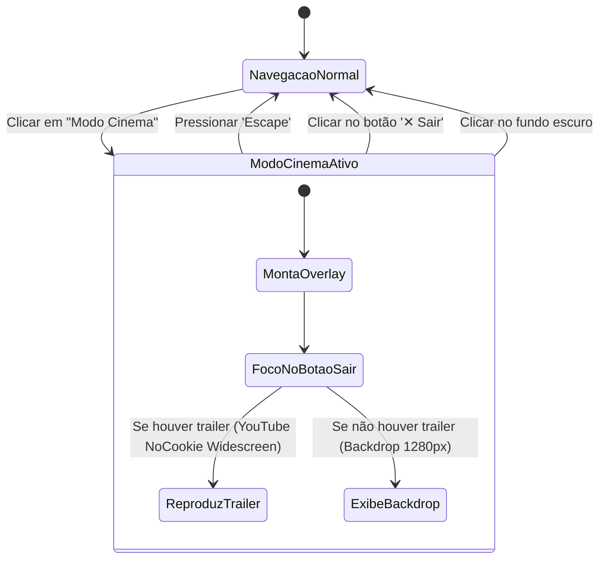
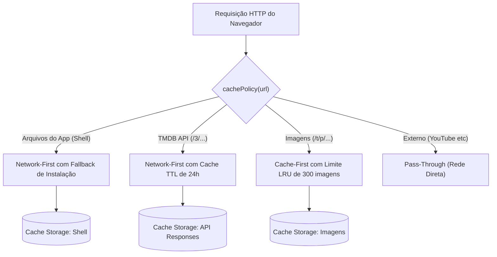

# Arquitetura do Movie App · Filmes e Séries

Este documento detalha o projeto arquitetural, decisões de engenharia, padrões de projeto e fluxos de dados do **Movie App**, uma aplicação completa de catálogo, recomendações inteligentes, listas personalizadas (watchlists), contador e métricas de tempo assistido, modo cinema e PWA offline.

---

## 1. Visão Geral e Filosofia Arquitetural

O projeto foi concebido sob duas premissas de engenharia:
1. **Dualidade de Implementação com Paridade Absoluta:**
   - **Versão JavaScript Puro (Vanilla):** Sem etapa de build (zero build-step), sem dependências externas (`node_modules` vazio em produção), usando estritamente módulos ES nativos (`type="module"`), DOM nativo seguro contra XSS e Service Workers.
   - **Versão Angular:** Framework moderno baseado em componentes standalone, Signals reativos e TypeScript, mantendo a exata mesma experiência de interface e regras de negócio.
2. **Resiliência e Segurança em Primeiro Lugar:**
   - Prevenção total contra Cross-Site Scripting (XSS): **nenhum** uso de `innerHTML`, `outerHTML`, `document.write` ou sinks de HTML inseguros.
   - Circuit Breaker e Cache LRU integrados ao cliente HTTP para suportar interrupções e cotas do TMDB.
   - Modo Offline nativo (PWA) permitindo navegação contínua mesmo sem conexão com a internet.
   - Armazenamento em envelope versionado e tolerante a corrupção em `localStorage`.



---

## 2. Diagrama de Camadas da Versão Vanilla

```mermaid
flowchart TB
    subgraph Apresentacao["Camada de Apresentação (UI / DOM)"]
        index["index.html"]
        style["style.css (Design System Escuro)"]
        dom["dom.js (h() Factory Segura)"]
        render["render.js (Componentes e Modais)"]
    end

    subgraph Roteamento["Roteamento e Controle"]
        router["router.js (Hash Router)"]
        app["app.js (State Machine & Bindings)"]
    end

    subgraph Dominio["Domínio e Regras de Negócio"]
        recommend["recommend.js (Afinidade & IA Local)"]
        watchtime["watchtime.js (Watch Time Tracker)"]
        lists["lists.js (Watchlists & Compact Share)"]
        format["format.js (Formatadores I18n)"]
        backup["backup.js (Serialização Segura)"]
    end

    subgraph DadosInfra["Persistência e Conectividade"]
        store["store.js (Local Storage Envelope)"]
        api["api.js (Cliente HTTP)"]
        lru["lru-cache.js (LRU + Circuit Breaker)"]
        offline["offline.js & sw.js (PWA Service Worker)"]
    end

    index --> app
    app --> router
    app --> render
    render --> dom
    app --> recommend
    app --> watchtime
    app --> lists
    app --> store
    app --> api
    api --> lru
    api --> offline
    app --> backup
```

---

## 3. Fluxo de Dados e Armazenamento Local

Todos os dados do usuário residem exclusivamente no navegador sob envelopes JSON estruturados com número de versão:

| Chave de Armazenamento | Tipo de Dado | Estrutura | Versão |
| :--- | :--- | :--- | :--- |
| `movie-app:favoritos` | Array de títulos | `[{ media, id, title, rating, posterPath, genreIds }]` | Migrado v2 |
| `movie-app:avaliacoes` | Array de avaliações | `[{ media, id, title, rating, text, updatedAt, genreIds }]` | Migrado v2 |
| `movie-app:listas` | Envelope de listas | `{"version": 1, "lists": [...]}` | v1 |
| `movie-app:tempo-assistido` | Envelope de tempo | `{"version": 1, "updatedAt": "...", "items": [...]}` | v1 |
| `movie-app:chave-tmdb` | String | Chave v3 (32 hex) ou Token v4 (Bearer JWT) | v1 |



---

## 4. Algoritmo de Recomendação e Afinidade Personalizada

O motor de recomendação em `recommend.js` executa inteiramente do lado do cliente (Client-Side Intelligence), preservando a privacidade total do usuário:

1. **Pontuação de Gêneros (`genreProfile`):**
   - Favorito: **+1** ponto.
   - Avaliação 5 estrelas: **+2** pontos.
   - Avaliação 4 estrelas: **+1** ponto.
   - Avaliação 3 estrelas: **0** pontos (neutro).
   - Avaliação 2 estrelas: **-1** ponto.
   - Avaliação 1 estrela: **-2** pontos.
   - Separação estrita entre `movie` e `tv` (gêneros com mesmo id têm semânticas diferentes).
2. **Cálculo de Afinidade Percentual (`calculateAffinityScore`):**
   - Compara os `genreIds` de um título com o perfil ponderado do usuário.
   - Calcula a razão de correspondência contra o score máximo do perfil.
   - Normaliza o resultado na faixa de 50% a 99% (ex: *"94% de afinidade"*).
   - Se o usuário não possui histórico ou não há interseção de gêneros, não exibe badge intrusiva.
3. **Explicações em Linguagem Natural (`explain`):**
   - Rastreia a procedência dos pesos: *"Porque você gostou de Matrix, Duna e Interestelar."*
4. **Exclusão de Conhecidos (`excludeKnown`):**
   - Títulos já favoritados ou avaliados são expurgados das fileiras de sugestão para evitar recomendações redundantes.



---

## 5. Contador e Métricas de Tempo Assistido (Watch Time)

O módulo `watchtime.js` provê rastreamento granular e métricas estatísticas:

- **Estimativa de Séries:** Quando o runtime de uma série não é detalhado por episódio, o sistema calcula inteligentemente:
  $$\text{Duração} = \text{Episódios} \times 45\text{ min} \quad \text{ou} \quad \text{Temporadas} \times 10 \times 45\text{ min}$$
- **Consolidação Estatística:**
  - Tempo total assistido em minutos, formatado em dias, horas e minutos em português (`formatWatchDuration`).
  - Total de filmes e séries concluídas.
  - Média de minutos consumidos por título.
  - Distribuição percentual de tempo por gênero com barras de progresso visuais.
  - Destaque do título mais longo assistido (`longestItem`).
  - Histórico cronológico reversível com desmarcação em 1 clique.

---

## 6. Modo Cinema (Cinema Mode)

O Modo Cinema oferece uma experiência imersiva para visualização de trailers e artes conceituais em alta definição:



- **Acessibilidade:** Ao abrir o Modo Cinema, o foco do teclado é transferido para o botão de saída, e a ação é anunciada para leitores de tela através da região `aria-live`. Ao fechar, o foco retorna ao título de detalhes.
- **Privacidade do Player:** O trailer usa a origem segura `youtube-nocookie.com` com autoplay apenas sob demanda explícita do usuário.

---

## 7. Estratégia PWA e Resiliência Offline

O service worker (`sw.js`) e as regras compartilhadas (`offline.js`) operam em 3 estratégias de cache complementares:



- **Manifesto PWA (`manifest.json`):** Declara modo `standalone`, orientação responsiva, ícones escaláveis SVG com suporte `maskable` e atalhos rápidos de navegação.
- **Prevenção de Dados Obsoletos:** Respostas da API armazenadas em cache recebem o cabeçalho sintético `x-cached-at`. Se o dado ultrapassar 24 horas (`API_TTL`), o service worker descarta a resposta expirada em vez de apresentar dados incorretos.

---

## 8. Segurança e Boas Práticas

1. **Zero HTML Ingestion:** Nenhuma variável ou dado da API é concatenado em strings HTML. Toda a árvore do DOM é criada por nós de texto via `h()` (`document.createElement`).
2. **Isolamento de Credenciais:** As chaves de API nunca são versionadas no Git. Arquivos de configuração reais (`config.js` e `config.json`) estão listados no `.gitignore`.
3. **Validação Estrita de Schemas:** Tanto links compartilhados (`decodeShare`) quanto backups JSON (`validateBackup`) realizam checagem exaustiva de tipos, comprimentos máximos e sanitização antes de tocar o `localStorage`.
4. **Resiliência a Quota:** Tentativas de escrita em `localStorage` capturam `QuotaExceededError` sem quebrar o fluxo da aplicação.

---

## 9. Suíte de Testes Automatizados

A suíte roda de forma ultrarrápida (menos de 2 segundos) usando o test runner nativo do Node.js (`node --test`), sem dependências pesadas:

- `tests/project.test.js`: Auditoria de segurança, ausência de chaves, integridade de UTF-8 e regras arquiteturais.
- `tests/watchtime.test.js`: Testes do contador, estimativas de séries, persistência, tolerância a falhas e métricas.
- `tests/recommend.test.js`: Algoritmo de afinidade, geração de perfis e explicações de recomendações.
- `tests/backup.test.js`: Serialização, restauração e validação de esquemas de backup JSON.
- `tests/router.test.js`: Cobertura de rotas por hash e parâmetros de URL.
- `tests/render.test.js`: Renderização de componentes contra ataques XSS e textos hostis.
- `tests/sw.test.js` & `tests/offline.test.js`: Políticas de cache e ciclo de vida do Service Worker.
- `tests/lru-cache.test.js`: Algoritmo de expulsão LRU e Circuit Breaker.
