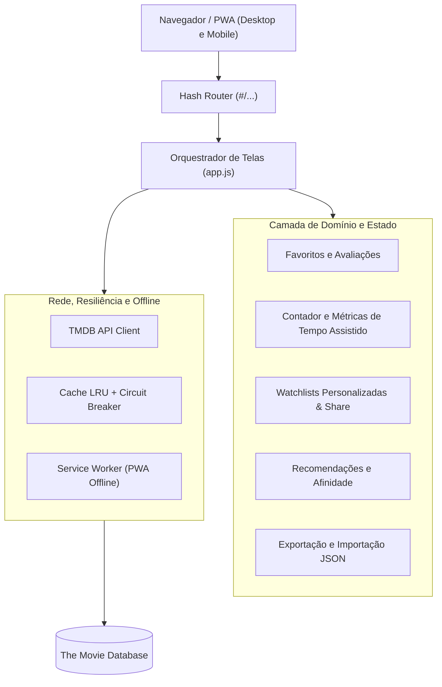

# Movie App: filmes e séries com a API do TMDB

Catálogo de filmes e séries que consome a API do [TMDB](https://www.themoviedb.org/), feito duas vezes:
uma em **JavaScript puro** (sem build, sem dependências) e outra em **Angular**. As duas versões têm as
mesmas telas e o mesmo visual, e servem para comparar as duas formas de construir o mesmo app.

> Este produto usa a API do TMDB, mas não é endossado nem certificado pelo TMDB.



## Funcionalidades

- **Início**: destaque em cartaz e faixas de filmes em cartaz, filmes populares, séries no ar e séries
  mais bem avaliadas.
- **Filmes** e **Séries**: listas "populares", "em cartaz / no ar" e "mais bem avaliados", filtro por
  gênero (os gêneros e seus ids vêm da própria API), busca por título com espera de 350 ms entre a
  digitação e a requisição, e paginação.
- **Detalhes**: sinopse, gêneros, nota, duração, temporadas e episódios, orçamento e receita, elenco,
  trailer do YouTube (o player só é carregado depois do clique), botão para marcar como assistido e Modo Cinema.
- **Modo Cinema (`🎬 Modo Cinema`)**: visualização cinematográfica imersiva para trailers e artes em widescreen,
  com backdrop escurecido (96% de opacidade), foco imediato nos controles e saída prática via tecla `Esc` ou botão dedicado.
- **Contador e métricas de tempo assistido (`#/tempo-assistido`)**: dashboard analítico em tempo real
  calculando o total de horas/dias consumidos em filmes e séries, estimativa de runtime por temporadas/episódios,
  gráfico de barras horizontais com a distribuição percentual por gênero, destaque para a obra mais longa assistida
  e histórico com desmarcação reversível.
- **Favoritos** e **avaliações** (nota de 1 a 5 e comentário), guardados no `localStorage` do navegador.
- **Listas personalizadas (Watchlists, `#/listas`)**: criar, renomear e excluir listas; adicionar e remover
  títulos pela página de detalhes (caixas de seleção em "Minhas listas" ou "Criar e adicionar");
  reordenar com os botões ↑ e ↓, que têm rótulo para leitor de tela e anunciam a nova posição.
  Envelope versionado (`{"version":1,"lists":[...]}`) com migração transparente e tolerância a falhas.
- **Compartilhar lista por link**: link compacto `#/lista/importar?d=…` com compressão `CompressionStream('deflate-raw')`
  em base64url. A lista é validada e pré-visualizada antes de salvar.
- **Recomendações e afinidade personalizada ("Para você", `#/recomendacoes`)**: motor de recomendação
  que pontua gêneros a partir de favoritos (+1) e avaliações (5★ = +2, 4★ = +1, 2★ = -1, 1★ = -2),
  com cálculo de afinidade percentual (`50% a 99%`) exibido nos títulos e explicações em linguagem natural.
- **Exportação e restauração completa em JSON**: exportação de todos os favoritos, listas, avaliações e
  histórico de tempo assistido em arquivo `.json` estruturado, com validação de esquema estrita contra arquivos adulterados.
- **Progressive Web App (PWA) e Modo Offline**: manifesto web (`manifest.json`) com ícones responsivos, tema escuro,
  instalação nativa em celular e computador, e service worker (`sw.js`) que cacheia shell da aplicação,
  respostas da API TMDB (TTL de 24h) e pôsteres com limite LRU de 300 imagens.
- Estados de carregamento, erro (com "tentar novamente"), lista vazia e "sem chave configurada".
- Interface em português, tema escuro, responsiva e acessível por teclado (WAI-ARIA).
- Os filtros ficam na URL (por exemplo `#/filmes?lista=top&genero=28&pagina=2`), permitindo navegação perfeita no histórico.
- Texto vindo da API nunca é inserido como HTML: na versão pura tudo passa por `createElement` e nós de
  texto; no Angular, pela interpolação padrão. URLs de imagem, site oficial e trailer são validadas.

## Estrutura

```
web-vanilla/            versão em JavaScript puro (módulos ES, sem build)
  index.html, style.css
  manifest.json         manifesto PWA com ícones e atalhos rápidos
  config.example.js     modelo de configuração (o config.js real fica fora do git)
  js/api.js             cliente do TMDB: URL, erros, normalização
  js/store.js           favoritos, avaliações e chave (localStorage)
  js/watchtime.js       rastreador de tempo assistido e cálculo de métricas
  js/router.js          rotas por hash e links
  js/format.js          formatação, paginação, debounce
  js/dom.js, render.js  criação de elementos e blocos de interface (Modo Cinema, Métricas)
  js/app.js             liga rota, API, estado e renderização
  js/lists.js           listas personalizadas: versão, migração e link de compartilhamento
  js/recommend.js       recomendações por gênero e score de afinidade
  js/offline.js         regras do modo offline, comuns à página e ao service worker
  sw.js                 service worker (cache do app, das respostas e dos pôsteres)
tests/                  testes da versão pura e dos dois service workers (node --test)
e2e/offline.e2e.mjs     teste num navegador de verdade (Playwright), só sob demanda
scripts/serve.mjs       servidor estático local, sem dependências
ARCHITECTURE.md         especificação e diagramas Mermaid da arquitetura
angular/                projeto Angular 22 (componentes standalone, signals, Vitest)
  public/config.example.json   modelo de configuração (o config.json real fica fora do git)
  public/sw.js          service worker do modo offline (registrado em src/main.ts)
  scripts/precache.mjs  depois do build, põe no sw.js a lista de arquivos a guardar na instalação
  src/app/core/         serviço do TMDB, interceptadores, configuração, favoritos/avaliações, tipos,
                        listas (lists.util/lists.service), recomendações e modo offline
  src/app/shared/       cartão, paginação, carregamento e erro
  src/app/features/     início, listagem, detalhes, favoritos, listas, importação de lista,
                        recomendações, ajuda da chave, não encontrada
.github/workflows/ci.yml
```

## Chave da API

Nenhuma chave está no repositório. Cada pessoa usa a sua, que é gratuita:

1. Crie uma conta em <https://www.themoviedb.org/signup>.
2. Em <https://www.themoviedb.org/settings/api>, solicite uma chave de desenvolvedor.
3. Use a **Chave da API** (v3, 32 caracteres) ou o **Token de leitura da API** (v4, começa com `eyJ`).
   A chave v3 vai na URL (`api_key=`); o token v4 vai no cabeçalho `Authorization`.

Onde colocar:

| Versão      | Arquivo real (ignorado pelo git) | Modelo versionado                    |
| ----------- | -------------------------------- | ------------------------------------ |
| web-vanilla | `web-vanilla/config.js`          | `web-vanilla/config.example.js`      |
| Angular     | `angular/public/config.json`     | `angular/public/config.example.json` |

`npm start` cria o arquivo real a partir do modelo na primeira vez; basta preencher `apiKey`.
Na versão pura também dá para colar a chave na tela "Configurar a chave da API" (link no rodapé):
ela fica salva só no `localStorage` daquele navegador.

Atenção: todo app que chama o TMDB direto do navegador expõe a chave a quem abrir as ferramentas de
desenvolvedor. Isso serve para estudo e uso pessoal. Para publicar para outras pessoas, ou cada visitante
informa a própria chave (o que a versão pura já permite), ou as chamadas passam por um servidor seu.

## ⚡ Quick Start (Início Rápido em 3 Passos)

Requer Node.js 22 ou mais novo:

1. **Clonar e Acessar o Repositório:**
   ```bash
   git clone https://github.com/seu-usuario/prototipo-de-app-de-filme-e-series.git && cd prototipo-de-app-de-filme-e-series
   ```

2. **Configurar Chave Gratuita do TMDB:**
   - Obtenha sua chave gratuita em [themoviedb.org](https://www.themoviedb.org/settings/api).
   - O `npm start` copia automaticamente `web-vanilla/config.example.js` para `web-vanilla/config.js` na primeira vez; basta colar sua chave lá (ou configurá-la direto pela interface web no rodapé).

3. **Iniciar a Aplicação:**
   - **Versão JavaScript Puro (Sem dependências):**
     ```bash
     npm start            # disponível em http://localhost:8080
     ```
   - **Versão Angular:**
     ```bash
     cd angular && npm install && npm start   # disponível em http://localhost:4200
     ```

## Como testar

```bash
npm test                      # versão pura e service workers: 188 testes com node --test
cd angular && npm test        # versão Angular: Vitest + jsdom
```

Nenhum teste acessa a rede: o `fetch` e o `HttpClient` são simulados. Os testes cobrem a montagem das
URLs (chave, idioma, busca codificada, gênero por id, janelas de data), o limite de 500 páginas, a
tradução de erros HTTP, favoritos e avaliações (inclusive `localStorage` corrompido ou cheio), as rotas,
a renderização com textos hostis e, em `tests/project.test.js`, regras do repositório: nenhuma chave
escrita em arquivo, nenhum `innerHTML`, arquivos em UTF-8 sem acentos corrompidos.

O CI (`.github/workflows/ci.yml`) roda os testes das duas versões e o build do Angular.

### Teste de ponta a ponta (sob demanda)

`e2e/offline.e2e.mjs` abre as duas versões no Edge ou no Chrome já instalados e confere, de verdade:
registro do service worker, recarga offline com os dados salvos e o aviso com a data, telas do
Angular nunca abertas funcionando offline (precache do build), gêneros de favoritos antigos
completados para as recomendações e o link comprimido de uma lista longa. O TMDB é simulado e a
chave é de mentira, gerada na hora. Não faz parte do `npm test` nem do CI e não instala nada no
projeto:

```bash
npm install --prefix <pasta-fora-do-projeto> playwright-core   # não baixa navegador
cd angular && npm run build && cd ..                           # só para testar o Angular
node e2e/offline.e2e.mjs --deps <pasta-fora-do-projeto> --angular angular/dist/angular/browser
# opções: --channel chrome (padrão msedge) e --headed
```

## Limitações conhecidas

- O app depende de uma chave pessoal do TMDB; sem ela só a tela de favoritos e a de configuração abrem.
- Favoritos e avaliações ficam no navegador: não há contas nem sincronização entre aparelhos.
- A busca por título não combina com lista e gênero, porque o endpoint de busca do TMDB não aceita esses
  filtros; a tela desativa os dois campos enquanto há texto na busca.
- O TMDB só entrega as 500 primeiras páginas de qualquer listagem.
- "Em cartaz" usa a janela das últimas seis semanas de lançamentos em cinema, sem filtro de país.
- O logotipo do TMDB, pedido nas regras de atribuição deles, não está incluído; a atribuição aparece em
  texto no rodapé. Quem publicar o app deve acrescentar o logotipo conforme
  <https://www.themoviedb.org/about/logos-attribution>.
- Na versão Angular, a chave só pode ser configurada pelo arquivo `config.json`.
- Listas e recomendações também ficam só no navegador; o link de compartilhamento é a forma de levar
  uma lista para outro aparelho.
- Modo offline: só funciona servido por `localhost` ou HTTPS (exigência dos service workers) e os
  dados da API só aparecem offline se já foram abertos online nas últimas 24 horas. No Angular, o
  service worker fica desligado no `ng serve`.

## Dados e atribuição

Todos os dados e imagens de filmes e séries vêm do [TMDB](https://www.themoviedb.org/). O uso da API
está sujeito aos [termos de uso do TMDB](https://www.themoviedb.org/api-terms-of-use).
